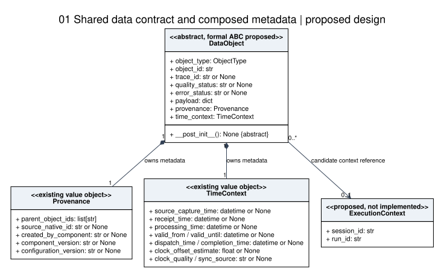
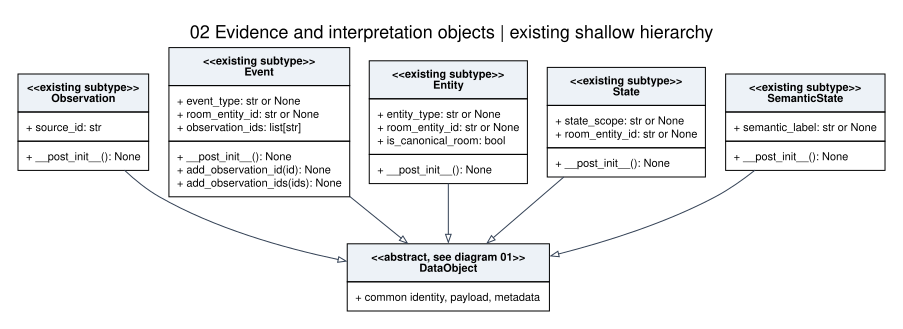
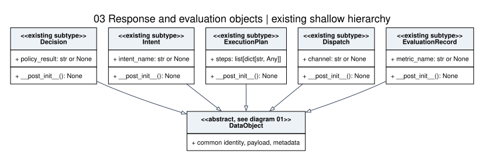
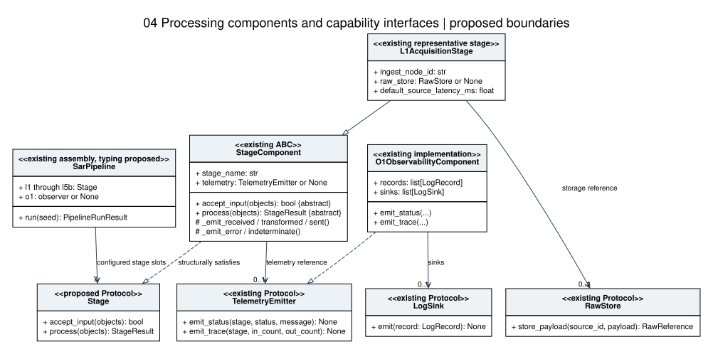
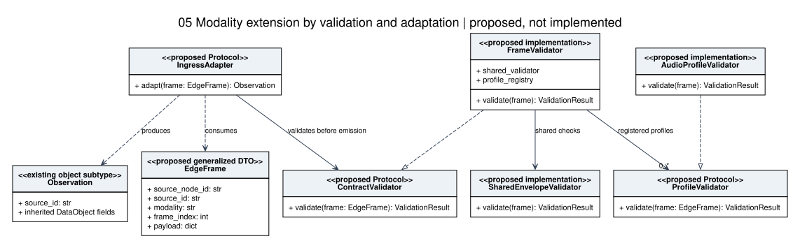

# SAR Object Abstraction and Interface Proposal

Status: Proposed for assessment, not approved or implemented

Version: 1. Date: 2026-10-28

Prepared for: Kazi Tamim Nomany, with AI assistance

Issue: [SAR #23](https://github.com/CHI-CityTech/Self-Aware-Room/issues/23)

Related specification: D02.01. This companion proposal does not allocate a new canonical Doc-ID.

Repository baseline: `8c99abecd723a39370455ba9e27adca2cea872b1`

## 1. Recommendation in plain terms

Keep one small abstract base for the information every SAR data object carries. Keep the ten existing concrete object categories as direct subclasses. Put source-specific and modality-specific requirements in profiles and validators. Use interfaces for interchangeable processing stages, telemetry, storage, and adapters. Keep the existing stage ABC for shared processing helpers.

Here, global means common to all SAR data-object instances. It does not mean one shared Python global variable, one value reused by all objects, or a singleton base object. Each observation, event, or decision keeps its own identity and metadata.

This proposal defines the abstract class, classifies current fields and methods, compares inheritance with interfaces, and supplies five assessable UML class views. No runtime files, live inventory records, or task statuses are changed. The diagrams show proposed design boundaries and explicitly label new interfaces and context extensions.

## 2. Baseline findings

The current [models module](../../../../src/sar_core/contracts/models.py) already defines `DataObject` and ten direct subclasses. `DataObject` rejects direct construction using a `__post_init__` guard, but it does not inherit Python `ABC` and has no abstract method. A subclass that does not override that hook can therefore bypass the intended abstraction boundary.

The current [stage contracts](../../../../src/sar_core/contracts/stages.py) already use `StageComponent(ABC)` with abstract `accept_input` and `process` methods. `TelemetryEmitter`, `RawStore`, and `LogSink` already use Python `Protocol`. This proposal preserves these choices rather than presenting them as new implementations.

D01.02 section 7 defines streaming conformance through field shape and semantics. D02.01 sections 2.2, 3.4, and 6.1 prefer composition, distinguish processing components from data artifacts, and describe modality profiles. These repository rules support shallow data inheritance plus capability interfaces.

## 3. Common fields on the abstract data object

| Existing field | Type | Why common | Proposed rule |
| --- | --- | --- | --- |
| `object_type` | `ObjectType` | Identifies the contract category | Fixed by the concrete subtype, not freely supplied to its constructor. Validate category/type consistency. |
| `object_id` | `str` | Identifies this particular data object | New ID for each newly emitted derived object. Preserve lineage to parents. |
| `trace_id` | `str` or null | Correlates related processing activity | Preserve through derivation where applicable. Not a replacement for object, run, or session identity. |
| `quality_status` | `str` or null | Describes evidence quality | Keep the field common. Allowed values and requiredness need contract review. |
| `error_status` | `str` or null | Describes an object-level error | Distinguish from stage status and log severity. |
| `payload` | Dictionary | Carries values or raw-data references | Common container, subtype/profile-specific contents. Do not require audio keys on every object. |
| `provenance` | `Provenance` | Records origin and parent linkage | Compose a metadata value object. Do not inherit from Provenance. |
| `time_context` | `TimeContext` | Records relevant timing and clock information | Compose a metadata value object. Required timestamps depend on boundary and object role. |

These are the eight fields currently declared on `DataObject`. Their presence does not imply that optional fields must contain values on every object. Type annotations and dataclass defaults do not validate wire data or enforce contract semantics.

Use per-instance default factories for dictionaries, lists, provenance, and timing. Do not use a shared mutable default or a class-level collection. Current defaults already use factories. Explicitly reusing a metadata instance can still create aliasing, so a later emission policy should copy or otherwise isolate mutable metadata.

## 4. Common metadata by composition

### 4.1 Provenance

Keep the five current fields together: `parent_object_ids`, `source_native_id`, `created_by_component`, `component_version`, and `configuration_version`.

`parent_object_ids` links derived records to prior records. Native frame identity identifies source evidence and does not replace the canonical SAR object ID. D01.02 requires an object ID on emitted observations even when the source provides a native ID. D02.01 section 4.3 needs its conditional native-ID wording reconciled with this requirement.

Generated-ID and estimated-time origin markers are a candidate provenance extension, not existing fields. Review their exact names and transport placement through T02/T03/T06. Issue 22's UID proposal is related work, not an approved dependency of this proposal.

### 4.2 TimeContext

Keep all ten existing fields in `TimeContext`: `source_capture_time`, `receipt_time`, `processing_time`, `valid_from`, `valid_until`, `dispatch_time`, `completion_time`, `clock_offset_estimate`, `clock_quality`, and `sync_source`.

L1 receipt and processing timestamps follow D01.02. A dispatch completion timestamp is not required on a raw observation. Do not invent source capture time without recording its estimated origin. Preserve source capture, receipt, and processing time as distinct meanings.

### 4.3 Run and session context

D01.04 requires run/session grouping, but the current `DataObject`, `TimeContext`, and `LogRecord` do not declare `run_id` or `session_id`. Do not claim that trace IDs already implement that policy.

Recommended future extension: an immutable `ExecutionContext(session_id, run_id)` associated with emitted objects and corresponding telemetry, or an equivalent approved serialized representation. Shared immutable context may be referenced by many objects. It is an association, not private composition. The diagram shows an optional reference during migration. Approval must decide when it becomes required, including how overlapping runs represent one source frame in several run associations. This proposal adds no such field to production code.

## 5. Fields and methods that belong to concrete subtypes

Keep these ten classes as direct children of `DataObject`. Semantic State is a separate contract category, not automatically a subclass of State. EvaluationRecord is a data artifact, not the O1 observer component or its LogRecord.

| Existing subtype | Fields declared by subtype | Existing subtype methods |
| --- | --- | --- |
| `Observation` | `source_id` | `__post_init__` |
| `Event` | `event_type`, `room_entity_id`, `observation_ids` | `__post_init__`, `add_observation_id`, `add_observation_ids` |
| `Entity` | `entity_type`, `room_entity_id`, `is_canonical_room` | `__post_init__` |
| `State` | `state_scope`, `room_entity_id` | `__post_init__` |
| `SemanticState` | `semantic_label` | `__post_init__` |
| `Decision` | `policy_result` | `__post_init__` |
| `Intent` | `intent_name` | `__post_init__` |
| `ExecutionPlan` | `steps` | `__post_init__` |
| `Dispatch` | `channel` | `__post_init__` |
| `EvaluationRecord` | `metric_name` | `__post_init__` |

The table covers every annotated subtype field in the baseline. All subclasses also inherit the eight common fields. The attached [field inventory](../../../assets/issue23/field_inventory.csv) records declared types and exact source lines across the inspected contract/support modules.

Keep `source_id` on Observation. A correlated Event may use several observations, so a single-source field should not become mandatory on all objects. Keep `room_entity_id` on its existing Event, Entity, and State types until another category has a reviewed requirement for that relationship.

`Event.add_observation_id` and `add_observation_ids` stay on Event. They keep observation IDs aligned with parent provenance. A generic Dispatch or Intent should not inherit event-aggregation methods.

`create_canonical_room_entity` remains a module-level factory for Entity. The current factory creates objects with room flags and identifiers. It does not enforce a process-wide singleton. `generate_object_id` and `utc_now` remain reusable module-level factories, not mutable global values or new base-object methods.

## 6. Define the abstract class

An abstract data class defines shared state and the minimum construction hook that a concrete category must implement. It cannot itself be emitted as a complete SAR artifact.

Recommended minimal formalization: retain the existing dataclass fields and construction behavior, inherit `ABC`, and mark `__post_init__` abstract. Every existing concrete category already overrides that hook. Keep its category assignment in the subtype. Do not add acquisition, processing, storage, or dispatch behavior to DataObject.

This is an illustrative definition for review, not an applied runtime change:

```python
from abc import ABC, abstractmethod
from dataclasses import dataclass, field
from typing import Any
from sar_core.contracts.identity import Provenance, generate_object_id
from sar_core.contracts.models import ObjectType
from sar_core.contracts.timing import TimeContext

@dataclass(slots=True)
class DataObject(ABC):
    object_type: ObjectType = field(init=False, default=ObjectType.OBSERVATION)
    object_id: str = field(default_factory=generate_object_id)
    trace_id: str | None = None
    quality_status: str | None = None
    error_status: str | None = None
    payload: dict[str, Any] = field(default_factory=dict)
    provenance: Provenance = field(default_factory=Provenance)
    time_context: TimeContext = field(default_factory=TimeContext)

    @abstractmethod
    def __post_init__(self) -> None:
        """Concrete types fix object_type and maintain local invariants."""

@dataclass(slots=True)
class Observation(DataObject):
    source_id: str = ""

    def __post_init__(self) -> None:
        DataObject.__post_init__(self)
        self.object_type = ObjectType.OBSERVATION
```

In a later implementation, modify the real models module rather than importing ObjectType from that module into itself. The imports above make the example executable as a separate review module. An empty source ID is retained to show baseline compatibility, not endorsement of an empty ID as a valid observation.

The abstract hook prevents constructing the base or an incomplete direct child. It does not make instances immutable, prevent later tag mutation, validate profiles, or prove semantic correctness. Separate validators should check invariants, and regression checks should cover all ten concrete categories before adoption.

## 7. Inheritance, interface, or composition?

| Case | Recommended mechanism | Reason and boundary |
| --- | --- | --- |
| Observation, Event, Entity, State, SemanticState, Decision, Intent, ExecutionPlan, Dispatch, EvaluationRecord | Shallow inheritance from DataObject | Each is a SAR data object with the same common state. Keep category-specific fields local. |
| Timing and provenance | Composition | An object has metadata. Metadata is not another kind of observation. |
| Shared construction defaults | DataObject dataclass plus abstract hook | Reuse identity/default allocation, without attaching processing capabilities. |
| Built-in processing stages | Existing StageComponent ABC | Reuse stage name, telemetry reference, and emission helpers. Override accept_input/process. |
| Pipeline substitution boundary | Proposed Stage Protocol | An alternate stage can provide the required signatures without inheriting SAR's helper implementation. Type stage slots against this interface after review. |
| TelemetryEmitter, RawStore, LogSink | Existing Protocol interfaces | Preserve replaceable capabilities with explicit method signatures. No DataObject inheritance. |
| Ingress adaptation | Proposed IngressAdapter Protocol | Adapts an edge frame to Observation. It is a processing capability, not a data subclass. |
| Shared/profile checks | Proposed validator interfaces and composed implementations | Apply common checks plus the declared modality's registered profile. |
| Audio, video, depth, and IMU details | Profile metadata and validation | Avoid AudioObservation-to-VideoObservation inheritance chains and modality methods on DataObject. |
| Serialization and raw evidence storage | Separate codec/store helpers | Storage and transport behavior should not spread across every data subtype. |

For the proposed Stage interface, retain the current signatures: `accept_input(input_objects: list[DataObject]) -> bool` and `process(input_objects: list[DataObject]) -> StageResult`. Structural substitutability includes compatible parameter and return types, not merely matching method names. Static typing does not enforce profile validity or lifecycle semantics at runtime.

Keep `StageResult.output_objects`, `status`, and `messages` in a result wrapper. Do not turn StageResult into a DataObject merely because it holds data objects. Keep operational component metadata, such as stage name, node identity, configuration, uptime, and heartbeat, on components or telemetry. Copy applicable creator/version information into object provenance on emission.

Keep `LogRecord` separate from `EvaluationRecord`: the former is an operational logging DTO, while the latter is an existing SAR artifact category. Keep stage `StageStatus`, object quality/error strings, and log `LogLevel` distinct until explicit mappings are specified.

## 8. Modality boundary and proposed signatures

The general frame should carry D01.02's five base fields. Its modality profile supplies additional requirements. The current `EdgeObservationFrame` requires `encoding`, `sample_rate_hz`, and `channel_count` even for other modalities. That is a known gap, not the recommended abstract-object design.

Recommended new interfaces for assessment:

| Proposed capability | Signature | Outcome |
| --- | --- | --- |
| `ContractValidator` | `validate(frame: EdgeFrame) -> ValidationResult` | Shared plus selected profile validation before emission |
| `ProfileValidator` | `validate(frame: EdgeFrame) -> ValidationResult` | Requirements for the selected modality/profile |
| `IngressAdapter` | `adapt(frame: EdgeFrame) -> Observation` | A validated source frame becomes a SAR observation |

Proposed `ValidationResult` contains `valid: bool` and structured issues identifying field, rule, and message. An adapter must not emit an ordinary valid Observation after a failed result. Error reporting, exceptions versus structured failure returns, schema versions, and any degraded path require contract review.

`FrameValidator` would combine shared-envelope checks with a profile registry keyed by modality and approved profile version. Unknown or unavailable profiles must fail or produce an explicitly approved degraded result. Register audio first against D01.02.01. Video/depth/IMU/control profiles remain planned, not implemented or approved by this proposal.

For audio, require encoding, sample rate, channel count, and sample format or bit depth as the profile specifies. Require explicit bit depth when encoding/sample format leaves numeric precision ambiguous. Do not move these fields into DataObject or invent sample-rate values for non-audio inputs. A successful demo path does not establish full shared/profile conformance.

## 9. UML class diagram set

Solid lines ending in a hollow triangle indicate inheritance. Dashed lines ending in a hollow triangle indicate interface realization. Filled diamonds indicate proposed ownership of per-object metadata. Other labeled lines are references or dependencies. Parameter names in diagrams are abbreviated. Sections 6 through 8 and the source inventory carry the precise signatures/types.

All five views belong to the same proposed design. Existing and new types are labeled. The two hierarchy views repeat DataObject only to keep each view readable. They do not create two base classes. Diagram 05's generalized EdgeFrame and validator types are proposed, not existing runtime implementations.

### 9.1 Shared contract and metadata



### 9.2 Evidence and interpretation subclasses



### 9.3 Response and evaluation subclasses



### 9.4 Processing interfaces



Only L1 is expanded as a representative built-in stage. The pipeline still has its seven configured stage slots. O1 realizes a telemetry interface, not DataObject. The diagram does not imply seven distinct stage instances are mandatory if a reviewed implementation reuses a stage.

### 9.5 Modality composition



The SVG files can be opened directly in a browser. Matching `.dot` files are editable Graphviz sources. The handoff package includes a standalone HTML report with all diagrams embedded, so review does not depend on a diagram server or GitHub rendering.

## 10. Acceptance and review cases

These cases define the proposed review target. The verification record distinguishes source inspection and isolated design checks actually performed from future integration tests.

| Case | Expected result |
| --- | --- |
| OBJ-01 | Direct construction of the proposed formal abstract DataObject fails. |
| OBJ-02 | A direct child that leaves the abstract hook unimplemented cannot be constructed. |
| OBJ-03 | All ten existing concrete categories remain constructible and keep their own object_type. |
| OBJ-04 | Separate instances have separate default payload, provenance, parent lists, and timing objects. |
| OBJ-05 | Event aggregation keeps observation IDs and parent provenance aligned without duplicates. |
| OBJ-06 | A processing stage is not a DataObject. O1 is not an EvaluationRecord. |
| OBJ-07 | Static interface checking rejects incompatible stage or sink signatures. |
| OBJ-08 | Shared frame validation does not require audio-only metadata for every modality. |
| OBJ-09 | Audio missing required precision information fails profile validation. |
| OBJ-10 | Unknown/unapproved profiles do not silently pass as validated. |
| OBJ-11 | Native frame identity is preserved alongside a separate SAR object ID. |
| OBJ-12 | Derived objects retain parent linkage and receive new object IDs. |
| OBJ-13 | Generated IDs and estimated timestamps carry approved origin metadata. |
| OBJ-14 | Run/session context reaches artifacts and telemetry according to D01.04. |
| OBJ-15 | Observation-to-dispatch serialization preserves the approved field names and categories. |
| OBJ-16 | Mutable metadata is isolated when a new derived artifact is emitted. |
| OBJ-17 | Canonical-room creation/lookup follows a separately agreed uniqueness policy. |
| OBJ-18 | Failed validation prevents normal observation emission and records the approved error outcome. |

## 11. Decisions and implementation sequence

Professor Smith should assess these recommendations:

1. Confirm the eight common fields and ten shallow concrete categories.
2. Confirm formal ABC enforcement through the existing construction hook.
3. Confirm capability interfaces for stage substitution and external adapters/validators.
4. Confirm metadata ownership, mutation, and serialization rules before introducing copies or frozen models.
5. Decide the representation and requiredness of run/session context and generated-value provenance.
6. Approve the diagram set and allocate any future canonical Doc-ID through repository governance.

Suggested sequence after approval: T04 for object schemas/lineage, T03 for identity propagation, T02/T06 for shared-envelope/provenance handling, T05 for validators, and T12 for profile compatibility. Confirm issue-to-task mappings before editing the task register. Issue 24's audio-contract evaluation should use the approved class decisions rather than assume this proposal is accepted.

D02.01 also calls for component and sequence diagrams. This issue's deliverable is the requested class diagram set. Those additional diagram types remain separate follow-up work and are not claimed complete here.

## 12. Sources and limits

Repository sources:

1. [D02.01 class/object model](../../D02.01_SAR_Computational_Class_and_Object_Model_V1_2026-07-27.md), sections 2, 3.4, 4, and 6.
2. [D01.02 shared contract](../../D01.02_SAR_Shared_Streaming_Contract_V1_2026-07-29.md), sections 4 through 8.
3. [D01.02.01 audio profile](../../D01.02.01_SAR_Audio_Streaming_Profile_V1_2026-07-29.md), section 4.
4. [D01.04 run/session policy](../../D01.04_SAR_Run_and_Session_Identity_and_Boundary_Policy_V1_2026-07-28.md).
5. [D04.03 task map](../../D04.03_SAR_Computational_Task_Dependency_Test_and_Milestone_Map_V1_2026-08-03.md).
6. [Models](../../../../src/sar_core/contracts/models.py), [identity](../../../../src/sar_core/contracts/identity.py), [timing](../../../../src/sar_core/contracts/timing.py), and [stage contracts](../../../../src/sar_core/contracts/stages.py).
7. [Edge adapter](../../../../src/sar_core/contracts/edge_ingress.py), [logging DTO](../../../../src/sar_core/contracts/observability.py), [raw storage](../../../../src/sar_core/storage/raw_store.py), and [log sinks](../../../../src/sar_core/observability_sinks.py).

External primary references checked October 28, 2026:

- [Python 3.12 ABC documentation](https://docs.python.org/3.12/library/abc.html): abstract methods prevent instantiation until concrete implementations exist. ABC alone is not sufficient without an abstract member.
- [Python typing specification: Protocols](https://typing.python.org/en/latest/spec/protocol.html): structural interfaces depend on compatible members rather than mandatory inheritance. They do not provide semantic runtime validation.
- [OMG UML 2.5.1 specification](https://www.omg.org/spec/UML/2.5.1/About-UML): authoritative UML reference. These simplified class views are design-review artifacts, not a claim of full model interchange or XMI validation.

The design recommendations are SAR-specific judgments based on these sources. No real inventory values, hardware performance, production schema migration, or completed runtime refactor are claimed.
