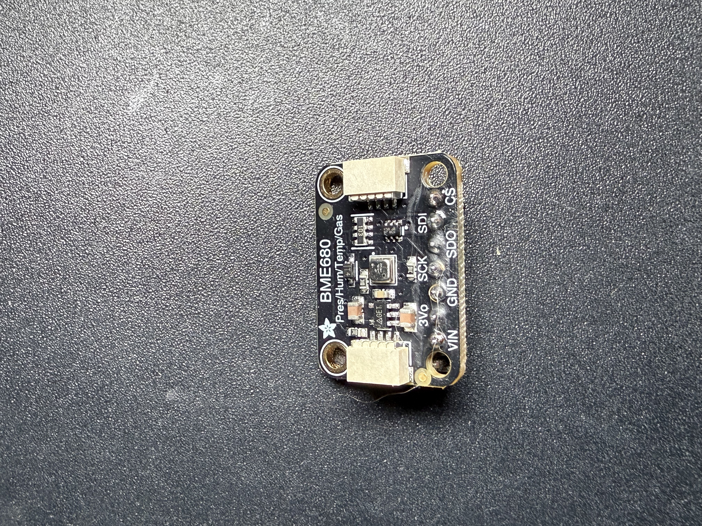
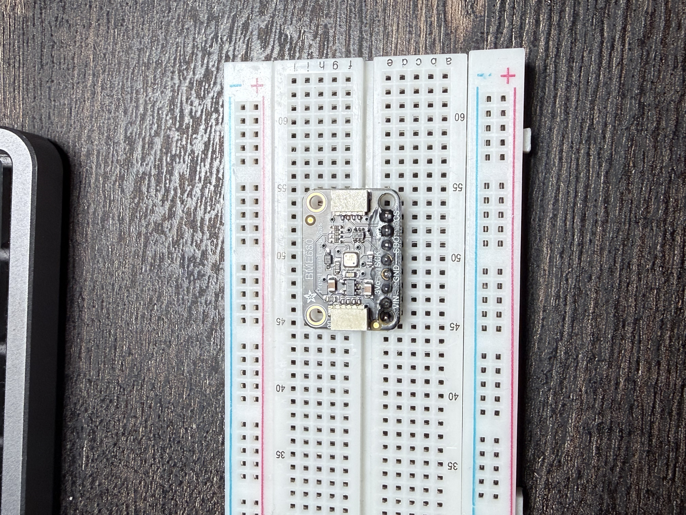
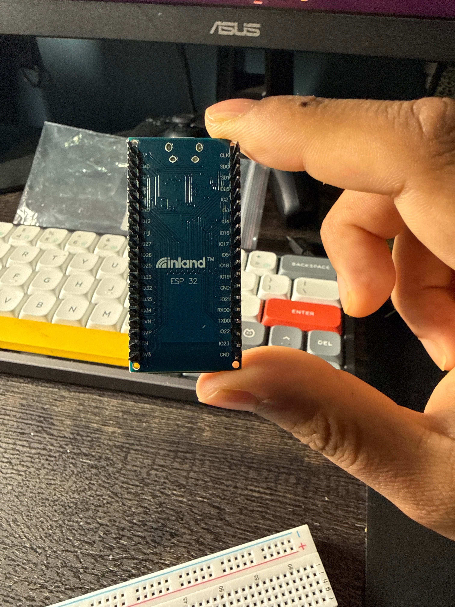
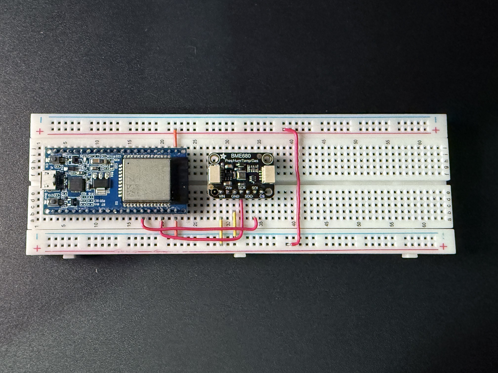
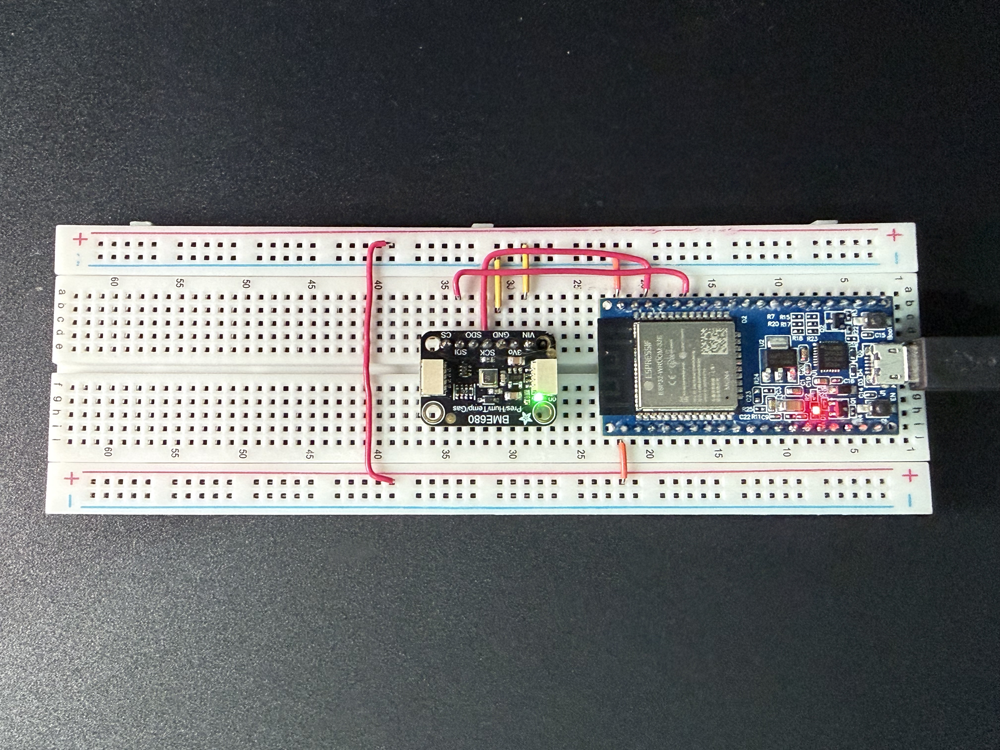
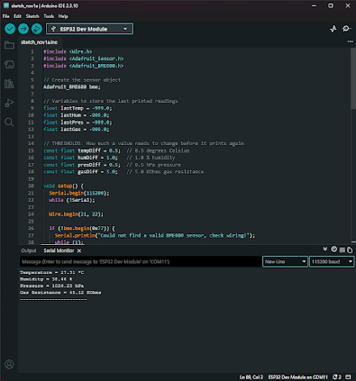

# SAR Environmental Node: Wired Baseline Validation

**Project:** Self-Aware Room (SAR)  
**Center:** Center for Holistic Integration (CHI), New York City College of Technology  
**Modality:** Environmental Sensing  
**Target Node:** ESP32 + Bosch BME680 Proof of Concept  
**Stage:** Stage B — Wired Baseline Validation  
**Author:** Jabber Bin Kibria  
**Supervisor:** Professor David B. Smith  
**Date:** November 1, 2026  

---

## 1. Objective
Validate the baseline physical data ingestion pipeline for the Self-Aware Room (SAR) project by establishing a stable, wired serial connection between the Adafruit BME680 environmental sensor and the Inland ESP32-WROOM-32 microcontroller.

## 2. Hardware Preparation
The BME680 breakout board was prepared by soldering the bottom header pins to allow flush mounting on a standard breadboard.




## 3. Wiring and Pinout Architecture
The BME680 supports both I2C and SPI. For this architecture, I2C was selected. 

**Reference Documentation:**
* [Adafruit BME680 Pinouts](https://learn.adafruit.com/adafruit-bme680-humidity-temperature-barometic-pressure-voc-gas/pinouts)
* [ESP32 Pinout Reference](https://docs.espressif.com/projects/esp-idf/en/latest/esp32/hw-reference/esp32/get-started-devkitc.html#pin-layout)
* Previous Stage Reference: [SAR_BOM_Environmental_Node_Stage_A_Breadboard_V1_2026-10-08.md](https://github.com/JabberBinKibria/Self-Aware-Room/blob/main/docs/sensors/SAR_BOM_Environmental_Node_Stage_A_Breadboard_V1_2026-10-08.md)

Initial wiring attempts incorrectly bridged the I2C data lines to the breadboard's power rails. This was corrected to a direct point-to-point architecture bypassing the unpowered side rails:
* **VIN** (BME680) -> **3V3** (ESP32)
* **GND** (BME680) -> **GND** (ESP32)
* **SCK** (BME680 SCL) -> **IO22** (ESP32)
* **SDI** (BME680 SDA) -> **IO21** (ESP32)





## 4. Workstation Configuration & Driver Troubleshooting
Upon connecting the ESP32 via USB, the Arduino IDE failed to recognize the COM port.
* **Diagnosis:** Windows Device Manager threw an error for the CP2102 USB to UART Bridge Controller due to missing drivers.
* **Resolution:** Installed the CP210x Universal Windows Driver (v11.6.0). The ESP32 successfully enumerated as `COM11` and the profile was set to **ESP32 Dev Module**.

## 5. Firmware Implementation
To prevent log flooding, the C++ firmware was engineered with a threshold-based reporting mechanism. The script only transmits data over the serial interface when environmental changes exceed defined deltas (0.5 °C for temperature, 1.0% for humidity, 0.5 hPa for pressure, and 5.0 KOhms for gas resistance).

```cpp
#include <Wire.h>
#include <Adafruit_Sensor.h>
#include <Adafruit_BME680.h>

// Create the sensor object
Adafruit_BME680 bme; 

// Variables to store the last printed readings
float lastTemp = -999.0;
float lastHum = -999.0;
float lastPres = -999.0;
float lastGas = -999.0;

// THRESHOLDS: How much a value needs to change before it prints again
const float tempDiff = 0.5;  // 0.5 degrees Celsius
const float humDiff = 1.0;   // 1.0 % humidity
const float presDiff = 0.5;  // 0.5 hPa pressure
const float gasDiff = 5.0;   // 5.0 KOhms gas resistance

void setup() {
  Serial.begin(115200);
  while (!Serial);

  Wire.begin(21, 22);

  if (!bme.begin(0x77)) {
    Serial.println("Could not find a valid BME680 sensor, check wiring!");
    while (1); 
  }

  Serial.println("BME680 connected. Waiting for environmental changes...");
  Serial.println("-----------------------");

  bme.setTemperatureOversampling(BME680_OS_8X);
  bme.setHumidityOversampling(BME680_OS_2X);
  bme.setPressureOversampling(BME680_OS_4X);
  bme.setIIRFilterSize(BME680_FILTER_SIZE_3);
  bme.setGasHeater(320, 150); 
}

void loop() {
  if (!bme.performReading()) {
    Serial.println("Failed to perform reading.");
    delay(2000);
    return;
  }

  // Grab the current readings
  float currentTemp = bme.temperature;
  float currentHum = bme.humidity;
  float currentPres = bme.pressure / 100.0;
  float currentGas = bme.gas_resistance / 1000.0;

  // Check if any reading has shifted past our defined thresholds
  bool changed = false;
  if (abs(currentTemp - lastTemp) >= tempDiff) changed = true;
  if (abs(currentHum - lastHum) >= humDiff) changed = true;
  if (abs(currentPres - lastPres) >= presDiff) changed = true;
  if (abs(currentGas - lastGas) >= gasDiff) changed = true;

  // If a significant change occurred, print it and update the saved states
  if (changed) {
    lastTemp = currentTemp;
    lastHum = currentHum;
    lastPres = currentPres;
    lastGas = currentGas;

    Serial.print("Temperature = ");
    Serial.print(currentTemp);
    Serial.println(" *C");

    Serial.print("Humidity = ");
    Serial.print(currentHum);
    Serial.println(" %");

    Serial.print("Pressure = ");
    Serial.print(currentPres);
    Serial.println(" hPa");

    Serial.print("Gas Resistance = ");
    Serial.print(currentGas);
    Serial.println(" KOhms");

    Serial.println("-----------------------");
  }

  delay(2000);
}
```


